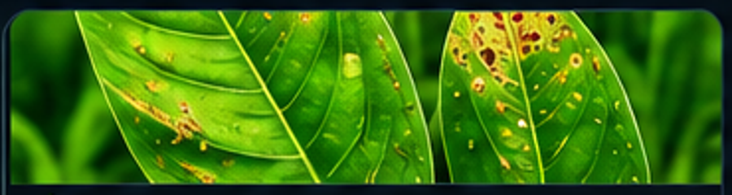
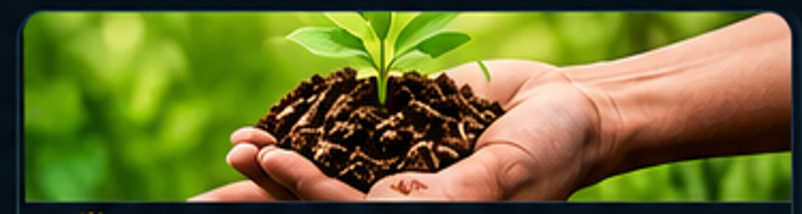
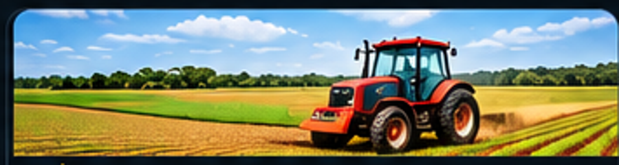

**Data Scientist | Machine Learning Engineer | MLOps | 🇰🇪 Kenya**

*Turning data into insight, models into products, and ideas into impact.*

---

## 👋 About Me

I'm a Mathematics and Computer Science graduate from **Jomo Kenyatta University of Agriculture and Technology (JKUAT)**. I enjoy combining statistics, programming, and machine learning to solve practical problems—and making analytical work useful through applications, dashboards, and clear communication.

- 🔍 **Focus:** Data Science, Machine Learning, and MLOps
- 🌍 **Domains:** Agriculture, health, finance, and public-sector data
- 🧪 **Approach:** Understand the problem → explore data → build → evaluate → deploy
- 🌱 **Currently learning:** Reliable ML pipelines, model explainability, and deployment
- 📍 **Based in:** Kenya

## 🛠️ Tech & Tools

 

## 🚀 Featured Projects

<table>
<tr>
<td width="50%" valign="top">

### 🌿 Crop Disease Detection

Computer vision for identifying crop diseases from leaf images; focused on image classification and an accessible prediction workflow.

**Stack:** Python · TensorFlow · Streamlit

</td>
<td width="50%" valign="top">

### 📊 Customer Churn Prediction

A machine-learning workflow to flag customers at risk of churn and investigate model predictions with explainability techniques.

**Stack:** Python · XGBoost · SHAP

</td>
</tr>
<tr>
<td width="50%" valign="top">

### 🌾 AgriFund

A farmer–investor micro-lending platform concept for agricultural financing, credit scoring, and impact tracking in Kenya.

**Stack:** React · Web technologies · Product design

</td>
<td width="50%" valign="top">

### 🌱 Crop Yield Prediction

A regression use case exploring how agricultural and environmental variables can support crop-yield estimates.

**Stack:** Python · Scikit-learn · Data visualization

</td>
</tr>
</table>

## 📈 GitHub Dashboard

## 🧭 What I'm Working Toward

- Designing reproducible end-to-end machine-learning projects
- Strengthening model validation, explainability, and experiment tracking
- Deploying models through APIs and lightweight web applications
- Exploring research questions using African datasets and local use cases
- Building tools that help people make better decisions with data

## 🤝 Connect With Me

 

**“Build with curiosity. Measure with rigor. Create impact.”** 🇰🇪

